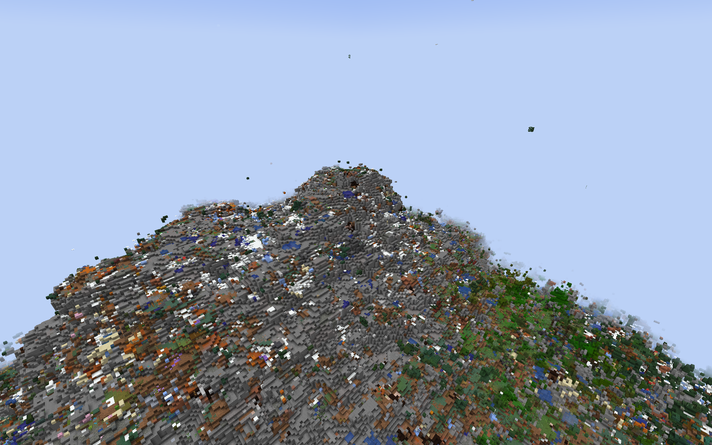
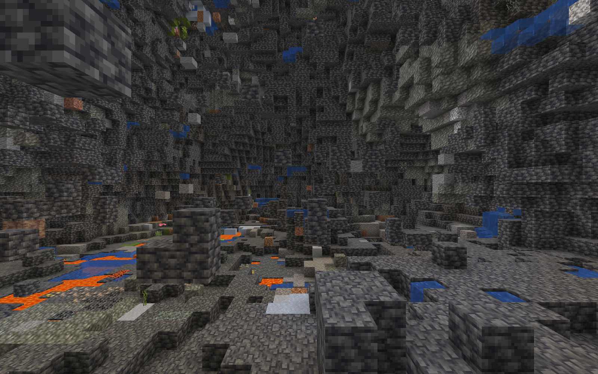

# Minecraft Terrain Diffusion — historical source archive

> **发布更正：本仓库归档的是已知存在破碎问题的旧版源码，不是用户要求的“最佳可用模型”。当前没有在此发布经过确认的最佳部署版本或其权重，请勿把本仓库作为该版本部署。** 详见 [发布状态与核查结果](docs/RELEASE_STATUS.zh-CN.md)。

Minecraft 三维地形扩散实验的源码与效果证据归档。生成流程包含地表引导、全局粗地形、三维细节扩散和体素解码，目标输出为可进入的 Minecraft Java 世界。

**当前状态：训练暂停；实验原型；尚无版本通过最终美观与物理验收。**

## 本仓库归档的历史版本

`terrain-v3-retained30k-20261107` 是有复现与选择记录的旧基线，已知生成结果存在破碎。它不应被当作用户要求的最佳可用发布。后续训练断点尚未证明完整世界效果更好，也不能直接据此替换成新最佳版本。

| 阶段 | 选择步数 | 参数量 | FP32 推理权重文件字节数 |
| --- | ---: | ---: | ---: |
| surface | 20,000 | 92,529,225 | 370,145,717 |
| coarse | 50,000 | 98,073,421 | 392,372,043 |
| fine | 30,000 | 98,184,896 | 392,816,973 |
| codec | 20,000 | 14,961,452 | 59,880,544 |

合计 303,748,994 参数，推理权重约 1.22 GB（1.13 GiB）。具体来源和哈希见 [MODEL_CARD.json](MODEL_CARD.json)。

固定输出区域为 512×512×384 格，共 1024 个原生区块。模型能表达地表起伏、地下洞穴、方块状态和生物群系，但存在悬浮块、碎散植被、材质混杂与洞穴岩石不自然的问题。局部截图不能代表整图质量。





全部 10 张截图在 [evidence/](evidence/)，来自原 MUSA 流水线的实际游戏 F2 画面，与原交付清单 SHA-256 一致。它们不是量化版本的结果。

## 仓库内容与使用边界

- `source/`：21 个原始源码模块，逐文件与保留版交付清单核对一致。
- `infer.py`：原交付版的可搬迁推理入口。
- `MODEL_CARD.json`：模型选择、规模、验证范围和已知问题。
- `docs/ORIGINAL_BUNDLE_GUIDE.zh-CN.txt`：原完整模型包说明；其中所说的包内资源不等于本 Git 仓库内容。
- `provenance/MANIFEST.json`：原完整交付包清单，用于记录来源；不表示本仓库包含清单全部文件。
- `tools/verify_source.py`：不依赖 PyTorch 的源码、截图完整性与 Python 语法检查。

**本仓库没有发布模型权重、原始世界、训练数据、完整归一化与词汇元数据、导出模板，也没有公开权重下载地址。因此仅克隆本仓库不能生成完整世界。** 权重与训练断点继续单独保存；未来发布资源时应核对原始哈希并补齐依赖。

```bash
git clone https://github.com/BorderRegion/minecraft-terrain-diffusion.git
cd minecraft-terrain-diffusion
python3 tools/verify_source.py
python3 infer.py --help
```

使用完整模型包时，另需 `weights/`、`metadata/`、`template/` 和包根目录的 `MANIFEST.json` 等资源。按照原说明安装与设备匹配的 PyTorch，然后执行包内校验与前向检查。训练脚本包含原实验路径，继续训练需要恢复数据并适配路径，不能直接把它们当成另一台机器上的可用路径。

## 资源与后续目标

原交付推理入口保留至少 18 GiB 空闲 GPU 显存的门槛。后续用户改写的逐阶段加载、逐瓦片解码服务曾报告在 RTX 4060 8 GB 上完成生成，但该服务不在此源码快照中，峰值显存未记录，不能据此承诺本入口支持 8 GB。

INT8/INT4、纯 CPU 低内存生成和 2 GB 峰值进程内存均为后续研发目标，尚无本模型的完整效果与内存实测。量化权重体积不等于运行内存；三维特征、中间场和卷积工作区也必须纳入预算。此处没有量化完成或实时运行的承诺。

当前只支持固定区域生成，尚未验收无缝、可接续的无限世界生成。世界导出回读成功也不代表流体、重力、生态和美观全部合格。

## 数据来源与依赖

保留版训练池记录为 2175 个世界，训练与验证按种子划分。来源包含 Minecraft Java 1.20.1、Fabric、Terralith 2.5.4 与 Chunky。Minecraft 程序、模组、驱动和游戏资产不随仓库分发；使用相关软件需遵守各自条款。PyTorch 根据 CPU/CUDA/MUSA 环境另行安装，基础 Python 依赖见 `requirements-base.txt`。

本仓库用于公开记录实验现状及来源。尚未指定额外的开源许可证；公开可见不应被理解为已授予任意再分发许可。
