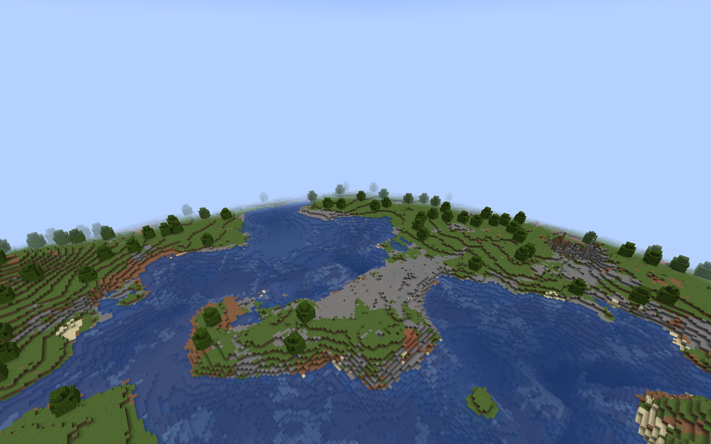
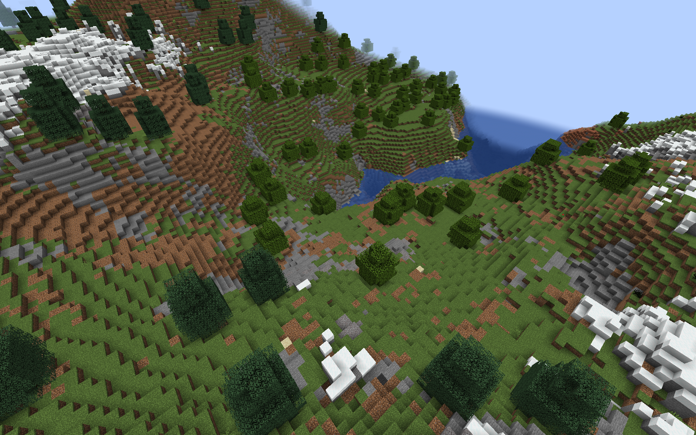

# Minecraft Terrain Diffusion — 高度场可用版

当前默认版本是 **`heightfield-expanded-v2-domain-v1`**：早期以地表为主的 2.5D 高度场模型，包含全局地形与条件局部细节两个模型。它是本次确认要发布的地表版本。

此前误放在仓库首页的破碎三维体素实验已移至 [`legacy/voxel-v3/`](legacy/voxel-v3/)，不参与本入口推理，也不是本次权重下载的内容。





这些是原正式交付中真实 Minecraft 客户端的 F2 截图，与交付清单 SHA-256 一致。完整证据共六张，见 [`evidence/`](evidence/)。不是本次 CPU 冒烟测试或量化后的画面。

## 模型与能力

| 阶段 | 选用 EMA 步数 | 参数量 |
| --- | ---: | ---: |
| 全局地形 | 98,000 | 92,528,457 |
| 条件局部细节 | 100,000 | 92,554,377 |
| 合计 | 两个训练计划均已完成 100,000 步 | 185,082,834 |

两份 FP32 推理权重合计约 **741 MB（约 706 MiB）**。它们由已保存的正式 `best.pt` 原始 EMA 张量恢复，没有量化。发布文件重新封装了 ZIP 容器并去掉训练状态和训练文件列表，因此文件 SHA 与历史导出文件不同；以本仓库的 [`WEIGHTS.json`](WEIGHTS.json) 为准。历史选择和验收见 [`provenance/ORIGINAL_DELIVERY.json`](provenance/ORIGINAL_DELIVERY.json)。

模型输出一片 512×512 的连续地表，包含地面高度、水面高度和七类材质。局部采用 64×64 窗口、32 格步幅，在物理高度域中融合。导出结果是一个连续的 Sponge v2 `.schem`，可以通过兼容工具导入 Minecraft Java 1.20.1 世界。

森林、湖岸、山地和雪地是这条路线的展示能力；树木与草花是导出时的确定性装饰。**没有学习三维洞穴、悬垂或完整生物群系生成，也不支持已验证的无缝无限扩展。** 局部陡沟、细尖岩柱和材质碎片仍存在；并非每个种子都漂亮，已验收种子 `90173` 为海洋。

## 安装与下载

建议使用独立 Python 环境。先安装适合设备的 PyTorch，再安装基础依赖：

```bash
git clone https://github.com/BorderRegion/minecraft-terrain-diffusion.git
cd minecraft-terrain-diffusion
python -m venv .venv
# Linux/macOS: source .venv/bin/activate
# Windows: .venv\Scripts\activate

# 纯 CPU 环境可使用以下版本；CUDA/MUSA 请安装与驱动匹配的版本。
python -m pip install torch==2.6.0 --index-url https://download.pytorch.org/whl/cpu
python -m pip install -r requirements-base.txt
python tools/verify_source.py
python tools/download_weights.py
```

权重放在 GitHub [Release](https://github.com/BorderRegion/minecraft-terrain-diffusion/releases/tag/heightfield-expanded-v2-20261103) 中，不塞进 Git 历史。下载工具逐个校验大小及 SHA-256，不需要访问原训练主机。也可手动将两份 `.pt` 和 `WEIGHTS.json` 下载至 `weights/`。

## 运行

先做快速冒烟检查。它只生成一个 64×64 小块、各阶段采样两步，**用于验证权重、代码和导出链路，不能判断最终效果**：

```bash
python infer.py --device cpu --smoke --steps 2 --batch 1 --out outputs/smoke
```

完整 512×512 生成：

```bash
python infer.py --device cpu --seed 1001 --steps 100 --batch 4 --out outputs/seed1001
# 有匹配的 CUDA 版 PyTorch 时：
python infer.py --device cuda --seed 1007 --steps 100 --batch 4 --out outputs/seed1007
# 原始 MTT/MUSA 后端：将 --device 改为 musa，并安装匹配的 torch_musa。
```

输出目录必须尚不存在。`status.json` 显示进度，完成后输出 `terrain_full.schem`、高度/材质数组和 `manifest.json`。schematic 的第零层对应 `manifest.json` 中 `full.min_y`，导入时须按该高度对齐；它不是可直接放进 saves 的完整 Anvil 存档。

原正式对比参数为 `steps=100, batch=4`。局部噪声使用 `seed + 1 + batch_start_index`，因此**改变 batch 会改变随机采样结果**。跨 CPU/CUDA/MUSA 的数值或像素完全一致没有得到验证。降低 batch 可以用于探索更小内存，但请保留默认参数作质量对照。

默认 `--water hydro` 使用原始实验性全局静水投影；原截图采用这一流程。它根据训练水位先验及模型湿区种子调整水面，属于显式后处理，并非模型直接学会的水动力学。`--water raw` 可保留高度边界投影后的模型水面。地形本身不做新增平滑或悬浮块清理。

## 验证范围与内存目标

原 MUSA 交付完成四个完整 512×512 区域检查，以及种子 1001、1007 的实际游戏画面和局部水更新测试；具体范围和局限见原交付记录。原水稳定性测试覆盖两个 96×96 已加载窗口，不代表任意世界和任意时长均稳定。

本次发布入口新增 CPU/CUDA/MUSA 设备选择、推理权重校验、按阶段释放模型和快速冒烟模式。原运行时的三个模块仅将强制 `torch_musa` 导入改为可选导入，原模型、采样器、物理域融合与导出算法保留。高度边界投影函数从原适配器原样提取。

新的测试结果见 [`docs/VALIDATION.json`](docs/VALIDATION.json)。CPU 小块运行验证不等于重新完成整图或游戏验收，也不提供 CUDA 显存上限保证。**极端量化和完整生成峰值进程内存不超过 2 GB 仍是待验证目标，本发布没有宣称达成。** 训练保持暂停。

## 依赖与许可

原数据来源包含 Minecraft Java 1.20.1、Fabric、Terralith 与 Chunky。游戏程序、模组、驱动、训练数据和优化器状态不随本发布提供。相关软件各自的条款仍适用。

本仓库尚未指定额外开源许可证。公开可见不代表授予任意再分发许可。
